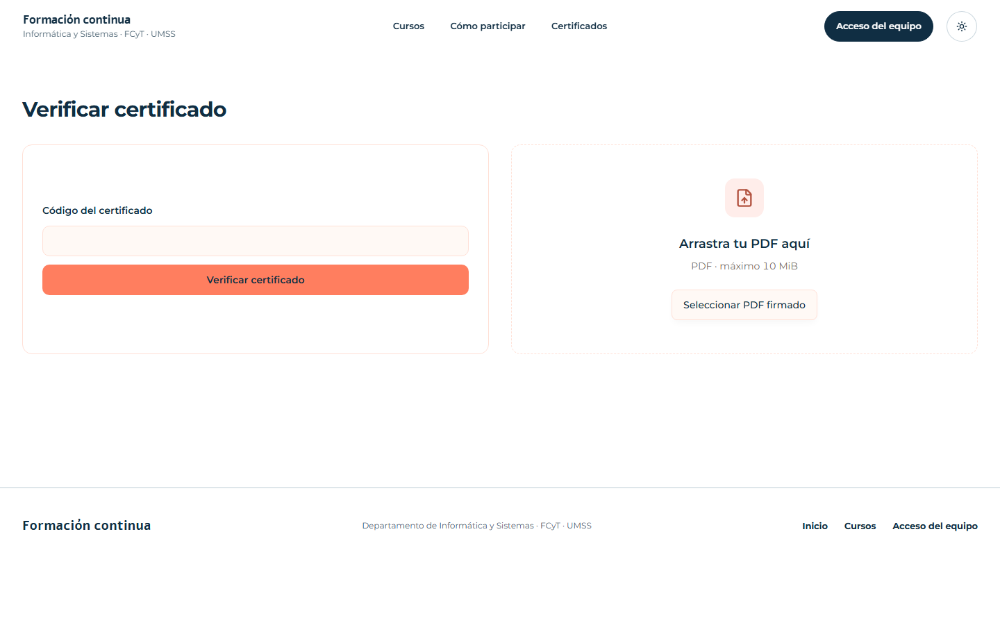

<div align="center">
  
  <p><strong>Plataforma web para la gestión integral de cursos de formación continua, asistencia, evaluaciones y certificación pública verificable.</strong></p>

  <p>
    <a href="https://github.com/SteveCasTo/skillbase/actions/workflows/ci.yml"></a>
    <a href="https://skillbase-alpha.vercel.app/"></a>
    <a href="https://bun.sh"></a>
    <a href="https://astro.build"></a>
    <a href="https://react.dev"></a>
    <a href="https://supabase.com"></a>
    <a href="https://tailwindcss.com"></a>
    <a href="LICENSE"></a>
  </p>

  <p>
    <a href="https://skillbase-alpha.vercel.app/"><strong>🚀 Explorar Demo en Producción »</strong></a>
  </p>
</div>

---

## VISTA PREVIA

<div align="center">
  <h3>Catálogo Público y Landing</h3>
  

<br/><br/>

  <h3>Portal de Verificación Pública de Certificados</h3>
  
</div>

---

# PLATAFORMA DE FORMACIÓN CONTINUA Y CERTIFICACIÓN

Plataforma web para gestionar el ciclo administrativo y académico de cursos de formación continua, desde su publicación y preinscripción hasta la evaluación, cierre del grupo, emisión de certificados y verificación pública de credenciales.

El sistema no pretende ser un LMS. No gestiona contenido educativo, clases virtuales, repositorios de material, foros o recursos de aprendizaje. Su alcance se centra en la operación de cursos, participantes, instructores, grupos, asistencia, evaluaciones, pagos administrativos, cierre y certificación.

## PRODUCTO

### Objetivo

Digitalizar y centralizar el flujo de gestión de cursos de formación continua del departamento, reduciendo tareas manuales, mejorando la trazabilidad de participantes e instructores y permitiendo emitir certificados verificables públicamente.

### Flujo principal

1. Administración registra y configura un curso.
2. El curso se publica en la plataforma.
3. Los interesados realizan una preinscripción.
4. Administración analiza la demanda y crea uno o más grupos.
5. Las personas se inscriben administrativamente.
6. Se registra el estado de pago y el valorado correspondiente.
7. El instructor gestiona asistencia y evaluaciones de sus grupos.
8. El sistema calcula resultados finales y elegibilidad para certificación.
9. Administración cierra el curso y genera documentación de cierre.
10. Se generan certificados.
11. Los certificados firmados se cargan al sistema.
12. Cada certificado puede verificarse públicamente mediante código y QR.

## ROLES PRINCIPALES

### Administrador

Responsable de la operación general del sistema.

Funciones previstas:

- Gestionar cursos.
- Publicar o retirar cursos.
- Gestionar preinscripciones.
- Crear y cerrar grupos.
- Asignar instructores.
- Gestionar inscripciones.
- Registrar condiciones de pago, descuentos y devoluciones.
- Consultar participantes.
- Supervisar asistencia y calificaciones.
- Gestionar cierre de cursos.
- Generar documentación administrativa.
- Gestionar certificados.
- Revocar o reemplazar certificados cuando corresponda.
- Consultar auditoría y reportes habilitados.

### Instructor

Responsable de la gestión académica de los grupos que le fueron asignados.

Funciones previstas:

- Consultar únicamente sus grupos autorizados.
- Consultar participantes inscritos.
- Consultar calendario y sesiones.
- Registrar asistencia.
- Configurar componentes de evaluación.
- Registrar calificaciones.
- Consultar resultados finales.
- Completar información requerida para el cierre del grupo.

### Participante

No necesariamente requiere una cuenta autenticada durante la primera versión.

Funciones públicas previstas:

- Consultar cursos publicados.
- Consultar información de un curso.
- Preinscribirse.
- Consultar información pública habilitada.
- Verificar certificados.

La autenticación de participantes podrá añadirse posteriormente si el producto lo requiere.

## REGLAS DE NEGOCIO INICIALES

Las reglas detalladas y sus criterios de aceptación se mantienen en `docs/REQUIREMENTS.md`.

Entre las reglas conocidas inicialmente se encuentran:

- Cursos de 30 horas pueden manejar sesiones aproximadas de 2,5 horas.
- Cursos de 20 horas pueden manejar sesiones aproximadas de 1,5 horas.
- Los precios pueden depender del tipo de participante.
- Los auxiliares elegibles pueden recibir un descuento del 50 %, sujeto a las condiciones definidas por administración.
- La preinscripción se utiliza para estimar demanda y determinar la cantidad de grupos.
- Un grupo que no alcance el mínimo requerido puede cerrarse.
- Puede habilitarse un grupo adicional cuando exista demanda suficiente.
- Los feriados que afecten sesiones deben permitir programación de reemplazo.
- La asistencia se controla por sesión.
- Las evaluaciones pueden ser teóricas, prácticas o mixtas.
- El instructor puede distribuir la nota final entre múltiples componentes de evaluación.
- El criterio base de aprobación conocido es 70/100, pero debe permanecer configurable.
- El criterio mínimo de asistencia también debe ser configurable.
- Los certificados deben poder verificarse públicamente.
- Un certificado revocado debe permanecer registrado, pero presentarse como no válido.

## STACK TECNOLÓGICO

Decisión inicial:

- Astro
- React
- TypeScript
- Bun
- Tailwind CSS
- shadcn/ui
- Sileo para notificaciones tipo toast
- Supabase
  - PostgreSQL
  - Auth
  - Storage
  - entorno local mediante Supabase CLI y Docker
- Drizzle ORM
- Playwright para pruebas E2E
- Vercel para producción
- GitHub Actions para CI/CD

Los detalles y responsabilidades de cada tecnología se documentan en `docs/ARCHITECTURE.md`.

## INICIO RÁPIDO

Requisitos: Git, Bun `1.4.2`, Node.js `24.x` y Docker con el daemon activo. En un equipo nuevo, clonar la rama `development`, instalar las dependencias y preparar `.env` antes del setup:

```sh
git clone -b development https://github.com/SteveCasTo/skillbase.git
cd SkillBase
bun install --frozen-lockfile
bun -e "await Bun.write('.env', Bun.file('.env.example'))"
```

En `.env`, sustituir los valores `replace-with-*` de Google OAuth por credenciales propias y establecer `DEV_INITIAL_ADMIN_EMAIL` con el correo de Google que accederá a `/app`. Registrar `http://127.0.0.1:55321/auth/v1/callback` como URI de redirección autorizado en Google, sin eliminar callbacks de otros entornos. La API local usa `55321` y PostgreSQL `55322`; la aplicación conserva `4321`. La clave pública local de Supabase se conoce **después** de iniciar los servicios:

```sh
bun run setup
bun run supabase:status
```

Copiar la clave **Publishable** de `supabase:status` a `PUBLIC_SUPABASE_PUBLISHABLE_KEY` en `.env` (nunca la clave Secret). Luego:

```sh
bun run dev
```

La aplicación queda disponible en `http://127.0.0.1:4321`. `setup` sincroniza Astro, instala Chromium, inicia Supabase local, **reinicia la base local** y aplica migraciones y formatos iniciales (20 h y 30 h). No ejecutarlo para conservar datos de una instalación anterior. Para llenar la landing y el catálogo con cursos ficticios sin borrar los existentes:

```sh
bun run db:seed:demo
```

El comando funciona únicamente contra Supabase local, crea una vez sus cursos de ejemplo y se puede repetir. El acceso al dashboard requiere iniciar sesión con la cuenta Google del correo preaprovisionado. Más detalles en `docs/DEVELOPMENT.md` y `docs/AUTHENTICATION.md`.

Para trabajo diario, después del setup inicial:

```sh
bun run supabase:start
bun run db:migrate
bun run dev
```

Usar `.env.example` como referencia; `.env` contiene credenciales locales y no se versiona.

## ENTORNOS

### Desarrollo

- Rama: `development`.
- Supabase local.
- PostgreSQL local.
- Auth local.
- Storage local.
- Datos de desarrollo reproducibles.

### Testing

- Cada ejecución de integración/E2E crea un Supabase temporal aislado y no accede a la base local de desarrollo.
- Fixtures o seeds de prueba controlados.
- Tests unitarios.
- Tests de integración.
- Tests E2E.
- Lint.
- Typecheck.
- Build de producción.

Comandos, lifecycle de los stacks temporales y limpieza opcional de fixtures heredados: `docs/TESTING.md`.

### Producción

- Rama: `master`.
- Supabase Cloud.
- Vercel.
- URL: `https://skillbase-alpha.vercel.app`.
- Supabase Cloud y Vercel están enlazados desde la Fase 1.
- Los pushes a `master` despliegan únicamente después de superar CI y aplicar migraciones Drizzle pendientes.

## DOCUMENTACIÓN

No leer toda la documentación indiscriminadamente. Consultar únicamente lo necesario para la tarea actual.

- `docs/ARCHITECTURE.md`: arquitectura, capas, módulos y estructura del repositorio.
- `docs/DESIGN.md`: sistema visual, UX, responsive, accesibilidad y componentes.
- `docs/PLAN.md`: plan incremental de implementación.
- `docs/TESTING.md`: estrategia de pruebas.
- `docs/DECISIONS.md`: decisiones técnicas y ADR.
- `docs/DEVELOPMENT.md`: flujo diario de desarrollo y Git.
- `docs/SECURITY.md`: seguridad, autorización, archivos y protección de datos.
- `docs/REQUIREMENTS.md`: requisitos y reglas de negocio.
- `docs/DATA_MODEL.md`: modelo conceptual y reglas de persistencia.
- `docs/AUTHENTICATION.md`: autenticación, sesiones y Google OAuth.
- `docs/CERTIFICATES.md`: emisión y verificación de certificados.
- `docs/DEPLOYMENT.md`: CI/CD, Vercel, Supabase Cloud y migraciones.

## PRINCIPIOS DEL PROYECTO

- Mantener una arquitectura modular.
- Favorecer simplicidad antes que abstracciones prematuras.
- No introducir servicios independientes sin una necesidad real.
- No desarrollar características fuera del alcance funcional acordado.
- Mantener lógica de negocio fuera de componentes UI y endpoints.
- Tratar la accesibilidad, seguridad, responsive y testing como requisitos, no como trabajo posterior.
- Mantener el entorno reproducible para cualquier integrante del equipo.

## CONTRIBUCIONES, SEGURIDAD Y LICENCIA

- Consulta la [guía de contribución](.github/CONTRIBUTING.md) y `AGENTS.md` antes de colaborar.
- Reporta vulnerabilidades mediante el [canal privado de GitHub](.github/SECURITY.md), no en issues públicos.
- Proyecto académico y de portafolio bajo [licencia MIT](LICENSE), © 2026 Steve (SteveCasTo). La licencia no sustituye las licencias de las dependencias ni concede derechos sobre marcas institucionales de terceros.
- Los [activos de presentación](assets/branding/README.md) son propios; las capturas muestran la interfaz pública, no acreditan oferta académica ni respaldo institucional.
